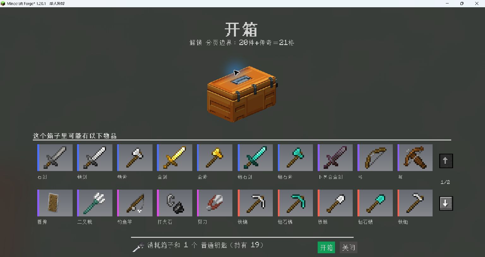
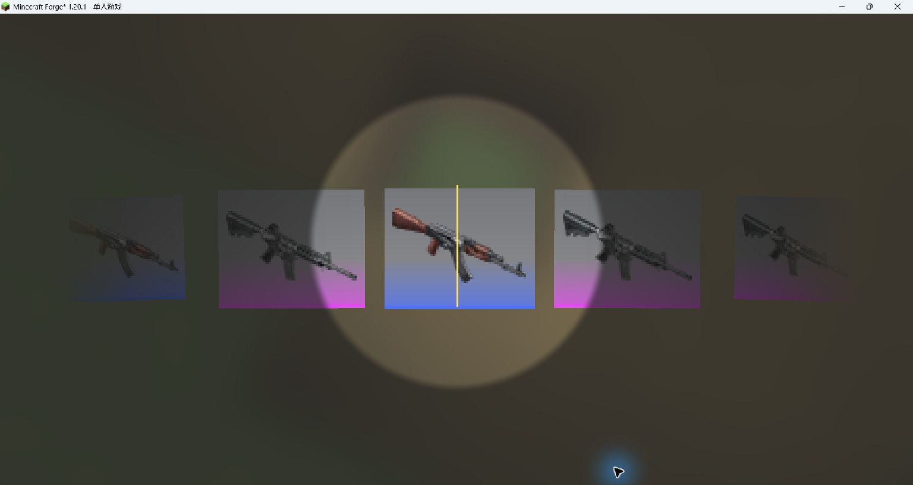

# CsgoBox

为 Minecraft 带来 CS 风格的开箱体验：浏览奖池、滚动抽奖、检视奖励，也可以把箱子放到世界中，观看开盖和掉奖动画。奖池、钥匙、概率、箱体外观和获取方式都能在游戏内配置。

[下载最新版本](https://github.com/Reclizer/CsgoBox/releases/latest) · [更新记录](CHANGELOG.md) · [范例配置](examples/box-appearances.json) · [MIT 许可证](LICENSE)

## 目前的功能

- **开箱与检视**：CS 风格的滚动滑条和圆形聚焦区域；奖励可点击检视、拖拽旋转，松手后平滑回正。
- **完整奖励预览**：蓝、紫、粉、红、金五档品质；主列表每页 20 格，超出后可翻页。金色奖励合并为一个「传奇物品」入口，点开查看全部传奇奖励。
- **地面箱子**：Shift＋右键放置，手持对应钥匙开启，依次播放开盖、滑条和掉奖动画。开完后的空箱可继续作为装饰使用。
- **三种消耗方式**：仅消耗箱子、仅消耗钥匙、同时消耗箱子和钥匙，可为每个奖池单独选择。
- **游戏内奖池编辑器**：新建、搜索、复制、删除配置，拖入奖励和钥匙，预览实际概率，选择外观并领取测试箱子。
- **自定义获取方式**：箱子和钥匙分别配置合成、实体掉落、村民交易；生物选择器支持搜索和多选其他模组的生物。
- **五款箱体外观**：金色武器箱、橙色武器箱、绿色扁平箱、铜粉雾蓝箱、芥末黄金属箱。
- **模组物品支持**：保留奖励的名称、附魔、数量和 NBT，可配置完整枪械等带数据的物品；JEI 中可查看已配置箱子及其获取方式。



*实机示例：奖励超过一页时，列表右侧显示翻页按钮。图中的奖池用于演示分页，实际奖励由配置决定。*



*实机示例：自定义枪械奖池的滚动开箱效果。*

## 开始使用

初次进入世界会生成三个范例奖池：武器箱、工具箱和补给箱，分别演示三种消耗方式。范例没有预设合成、掉落或交易规则，可通过创造物品栏、编辑器的「获取测试箱子」或管理员命令获得。

### 手持开箱

1. 将箱子拿在主手，右键打开预览。
2. 浏览奖池，点击普通奖励可进入检视；点击「传奇物品」可查看金色奖励清单。二级页面可用「返回」或 Esc 返回。
3. 按界面底部提示准备所需物品，再点击「开箱」。

在背包中将鼠标移到箱子上，按住 **Shift** 可以展开非金色奖励名称，名称按品质着色。金色奖励在开箱预览的传奇入口中查看。

手持开箱的奖励会在开始播放动画时发放，背包装不下的部分掉落到脚边。关闭动画不会取消已经发放的奖励。

### 放到地面开箱

1. 拿着箱子，**Shift＋右键地面**放置，箱子下方需要完整支撑面。
2. 若配置了钥匙，将对应物品拿在主手或副手，右键箱子。拿错或没有拿钥匙时，会提示所需物品的具体名称。
3. 箱子开盖后显示实时滑条，动画结束时从箱体上方弹出奖励。

| 消耗方式 | 手持开箱 | 地面开箱后的状态 |
|---|---|---|
| 仅箱子 | 消耗 1 个箱子，无需钥匙 | 转为空箱；如果配置了钥匙，需手持解锁，但不消耗钥匙 |
| 仅钥匙 | 消耗 1 个钥匙，保留箱子 | 掉出奖励后等待 2 秒，自动关盖复位，可再次使用钥匙开启 |
| 箱子和钥匙 | 各消耗 1 个 | 转为空箱 |

钥匙可以使用任意物品；不需要钥匙功能时，清空钥匙槽并选择「仅箱子」。

仅填写钥匙物品 ID 时按物品类型匹配；使用带 NBT 的物品取样时，钥匙需要匹配完整数据。

空箱右键即可切换开合，破坏后掉落对应外观的空箱，重新放置也可继续作为装饰，但不会再产出奖励。

地面开箱在解锁时就确定本次奖励。滑条中途被破坏，会直接掉落已确定的奖励：仅钥匙模式掉回可用原箱子，另外两种模式掉空箱。已经弹出的奖励不会重复发放。

## 游戏内奖池编辑器

管理员从创造物品栏获取「奖池编辑器」，拿在主手右键打开。使用编辑器及管理命令需要权限等级 2。

### 创建并测试一个奖池

1. 点击左侧「＋ 新建奖池」，填写奖池名称；也可以加载已有配置后点击「复制为新奖池」。
2. 在「奖励」页选择品质，将背包取样区中的物品**拖入奖励区**。根据需要设置奖励数量、钥匙和消耗方式。
3. 到「概览预览」页设置各品质权重和幸运值开关，检查实际概率。
4. 到「箱体外观」页选择模型；需要合成、掉落或交易时，再到「物品获取」页配置。
5. 点击「保存并应用」，或按 **Ctrl＋S**。保存后立即生效，无需额外重载。
6. 点击「获取测试箱子」领取当前箱子；配置了钥匙时会附送一把对应钥匙。测试箱子会正常消耗物品并发放奖励。

### 奖励

蓝、紫、粉、红、金五档分别管理奖励。选择奖励后可以修改数量，右键奖励可删除；也可以输入物品 ID 后点击「添加奖励」。

| 品质 | 建议数量 | 配置字段 |
|---|---:|---|
| 蓝色 | 7 | `grade1` |
| 紫色 | 5 | `grade2` |
| 粉色 | 3 | `grade3` |
| 红色 | 2 | `grade4` |
| 金色／传奇 | 不设建议数量 | `grade5` |

前四档会标出建议格。建议数量不会限制添加，每个奖池最多支持 **256 条奖励**。开箱预览每页 20 格，所有金色奖励合并占用一个展示格，超出后翻页查看。

从背包取样会复制物品的数量、名称、附魔和 NBT，不会移动真实物品。背包样品需要拖入目标区域，左键单击不会直接添加。

右侧的「开箱所需物品（钥匙）」槽也支持拖入，右键可清空；下方可切换三种消耗方式。钥匙样本固定为 1 个，清空钥匙会切回「仅箱子」并关闭钥匙获取规则。

### 物品获取

先选择「箱子获取」或「钥匙获取」，再从左侧列表选择一种方式。三种方式分别启用，也可同时启用；全部关闭时，该物品不会通过这些规则自动产出。

| 获取方式 | 配置内容与操作 |
|---|---|
| 合成 | 从背包拖入材料，设置 3×3 有序配方和产出数量。每格消耗 1 个材料，支持配方移动及左右镜像 |
| 掉落 | 设置掉落概率、数量和生物。点击「选择实体」，按名称、实体 ID 或模组搜索，可多选、翻页和只看已选 |
| 村民交易 | 设置职业、等级、第一材料、可选附加材料、产出数量、最大交易次数和村民经验 |

右键材料槽可清空。交易会加入对应职业的随机候选列表，不保证每位村民都有；已经生成的村民交易不会被直接替换。

### 概览预览

设置五档品质的**相对权重**，无需凑成 100。空品质和权重为 0 的品质不参与抽奖，其他品质按有效权重重新计算概率；同品质内的奖励等概率抽取，重复条目的概率累加。

「幸运值影响」开启时，玩家幸运值会影响稀有度概率；关闭时使用配置权重。可以输入一个幸运值，或点击「使用当前幸运值」查看概率变化，预览不会修改玩家属性。

### 箱体外观与配置管理

在「箱体外观」页点击模型选择外观，保存后该奖池已有的箱子也会同步更新。

左侧列表支持按名称或 ID 搜索。新建和复制会生成新的固定 ID；重命名不会改变箱子的归属。删除配置前会要求确认，删除后该奖池的已有箱子将无法开启。

有未保存修改时，切换配置或关闭编辑器会提示处理草稿。若其他管理员或文件编辑已修改同一奖池，保存会拒绝覆盖，请重新加载最新配置后再编辑。

## 配置文件

### 奖池配置

奖池文件位于 `config/csbox/box.json`。单人游戏使用本地配置，多人游戏使用服务器配置。建议先用编辑器完成一个奖池，再参考生成的 JSON 批量调整。

文件最外层为数组，每个对象是一份奖池。例如：

```json
[
  {
    "id": "csgobox:my_case",
    "name": "我的武器箱",
    "appearance": "gold",
    "consumption": "both",
    "key": "csgobox:csgo_key0",
    "luckEnabled": false,
    "random": [2, 5, 6, 20, 625],
    "grade1": ["minecraft:iron_sword", "minecraft:diamond.withCount(3)"],
    "grade2": ["minecraft:diamond_sword"],
    "grade3": ["minecraft:diamond_axe"],
    "grade4": ["minecraft:netherite_sword"],
    "grade5": ["minecraft:elytra"]
  }
]
```

| 字段 | 作用 |
|---|---|
| `id` | 唯一且固定的奖池标识，使用 `命名空间:路径`，如 `csgobox:my_case` |
| `name` | 游戏内显示名称，可以修改 |
| `appearance` | `gold`、`orange`、`green`、`rose_blue` 或 `yellow_metal` |
| `consumption` | `box` 仅箱子、`key` 仅钥匙、`both` 箱子和钥匙 |
| `key` | 所需钥匙的物品描述；`key` 和 `both` 模式必须填写 |
| `luckEnabled` | 是否让玩家幸运值影响概率 |
| `random` | 品质权重，顺序为 **金、红、粉、紫、蓝**，与 `grade1`～`grade5` 的顺序相反 |
| `grade1`～`grade5` | 蓝、紫、粉、红、金五档奖励 |
| `acquisition` | 箱子的获取规则，包含 `crafting`、`drop`、`trade` |
| `keyAcquisition` | 钥匙的获取规则，结构与 `acquisition` 相同 |
| `displayOrder` | 编辑器维护的常规奖励展示顺序，通常无需手工填写 |

物品描述支持 `.withCount(n)` 指定数量、`.withTags{...}` 指定原生 SNBT。对于带附魔、自定义名称或枪械型号等数据的物品，直接在编辑器中拖入完整物品更方便。

箱子只记录奖池 ID，修改名称、奖励或外观后，已有箱子会使用更新后的配置。不要随意修改已经投入使用的 `id`；修改 ID 或删除配置后，旧箱子无法找到原奖池。

### 获取规则示例

以下内容可填入某个奖池的 `acquisition` 或 `keyAcquisition`。各方式的 `enabled` 独立控制是否开启：

```json
{
  "crafting": {
    "enabled": true,
    "ingredients": [
      "", "minecraft:iron_ingot", "",
      "minecraft:iron_ingot", "minecraft:chest", "minecraft:iron_ingot",
      "", "minecraft:iron_ingot", ""
    ],
    "count": 1
  },
  "drop": {
    "enabled": true,
    "chance": 0.1,
    "entities": ["minecraft:zombie"],
    "count": 1
  },
  "trade": {
    "enabled": true,
    "profession": "minecraft:weaponsmith",
    "level": 2,
    "cost": "minecraft:emerald.withCount(8)",
    "secondCost": "",
    "count": 1,
    "maxUses": 12,
    "xp": 5
  }
}
```

合成的 `ingredients` 必须保留 9 格，空格使用 `""`。JSON 中掉落概率使用 **0～1**，例如 `0.1` 表示 10%；编辑器中则直接填写百分比。

### 应用修改与管理命令

手工修改 JSON 后执行：

```mcfunction
/csgobox reload
```

编辑器的「保存并应用」会直接更新文件并生效，无需再次执行命令。重载失败会继续使用之前的有效配置；成功后重新打开箱子预览即可查看更新。

按奖池 ID 领取箱子：

```mcfunction
/csgobox give csgobox:example_weapons
```

首次生成的三个范例 ID 为 `csgobox:example_weapons`、`csgobox:example_tools`、`csgobox:example_supplies`。完整内容见 [范例配置](examples/box-appearances.json)，可参考或合并到自己的文件中，注意保持 ID 唯一。

### 客户端显示配置

`config/csgobox-client.toml` 控制本机的界面效果，修改后自动读取：

```toml
[display]
blurEnabled = true
backgroundOpacity = 0.5
tacz3dPreview = true
```

| 配置项 | 作用 |
|---|---|
| `blurEnabled` | 是否启用开箱背景模糊 |
| `backgroundOpacity` | 背景不透明度，范围 0～1 |
| `tacz3dPreview` | TaCZ 枪械奖励是否使用三维检视；关闭后使用背包图标 |

## 自定义模型与许可证

五款箱子的 Blockbench 工程和原贴图保存在 `blockbench/appearances/`，修改和导出方法见 [模型编辑说明](blockbench/README.md)。

本项目采用 [MIT 许可证](LICENSE)。
